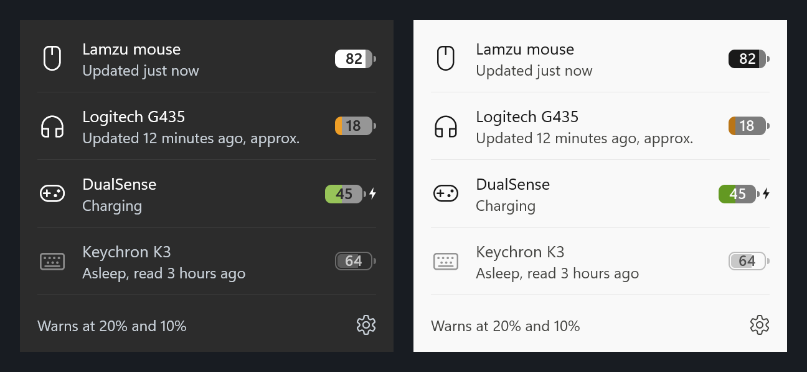

# BatteryStrip

**[Русский](README.ru.md)** · English

A tiny strip on the Windows 11 taskbar, right next to the clock, that shows the charge of your wireless devices:
mouse, headset, controller, keyboard. It finds them by itself and shows as many as are connected.


> **Beta.** Two devices have been tested on real hardware so far: a Lamzu mouse and a Logitech G435 headset.
> Everything else is implemented from public protocol documentation and needs testers.
> If your device is listed below, please tell us whether it works.

- **Colours**: white on a dark taskbar, black on a light one; yellow at 20% and below, red at 10% and below;
  green with a bolt while charging. A sleeping device is faded and keeps its last known value; a dash means
  the device does not report its charge.
- **Click** the strip for the list of devices with their state. The gear opens the settings.
- **Notifications** when a device drops to 20% and to 10%, once each.
- **Follows the taskbar**: light or dark theme, Explorer restarts, sleep, a crowded taskbar (the icons go first,
  then the devices move to tray icons).
- **Small and quiet**: one 300 KB file, about 25 MB of memory, close to zero CPU. No administrator rights,
  no runtime to install, no ads, no telemetry. The only network access is an optional daily update check.
- **Languages**: Russian and English, following Windows.



## Install

1. Download `BatteryStrip-<version>.exe` from [Releases](../../releases).
2. Run it and confirm. It installs for the current user only, without administrator rights, and starts with Windows.
3. The strip appears as soon as the first device reports its charge.

**"Windows protected your PC"**: the app has no paid code-signing certificate yet, so SmartScreen warns about new
downloads. Click *More info* → *Run anyway*. Each release page lists the SHA-256 of the file. Releases built by the
[release workflow](.github/workflows/release.yml) also carry a build attestation you can check with
`gh attestation verify BatteryStrip-<version>.exe --repo kantemiir/BatteryStrip`.

**Update**: run the newer file, or turn on *Check for updates* under the gear.
**Uninstall**: *Settings → Apps → Installed apps → BatteryStrip → Uninstall*. Settings, log and autostart go too.

## Supported devices

| Devices | How the charge is read | Tested |
|---|---|---|
| Mice on the COMPX chipset (receiver 25A7): **Lamzu**, Ajazz, Attack Shark, VXE and others | Exact percent and charging state. If the vendor app is running, its own requests are reused and the mouse is not asked again. | Lamzu ✔ |
| **Logitech G435** on its own receiver (046D:0ACB) | Estimated from the battery voltage. Reading pauses the headset's audio for about a second, so it is **off until you agree**; then it happens at most every 30 minutes and only during silence. | ✔ |
| **Logitech HID++** mice, keyboards and headsets on Unifying, Bolt, Lightspeed and by cable (G Pro, G305, G502 X, MX Master, G733, G535 and others) | Exact percent or a voltage estimate, depending on the device. Standard read requests, the same G HUB and Solaar send. | needs testers |
| **Bluetooth** headphones, speakers, mice, keyboards (AirPods, Sony, JBL and others) | The value Windows shows in *Settings → Bluetooth*, read from Windows without touching the device. | needs testers |
| **DualSense**, DualSense Edge, **DualShock 4**, by cable and Bluetooth | In 10% steps, with charging state, from the reports the controller sends anyway. | needs testers |
| **Xbox** and compatible controllers | What Windows reports for the controller. | needs testers |

Not supported yet: Razer, SteelSeries, HyperX, Corsair and other vendor-specific protocols.

### Your device is missing or wrong?

Run

```
"%LOCALAPPDATA%\Programs\BatteryStrip\BatteryStrip.exe" --diagnose
```

After 40 seconds a report opens (`%LOCALAPPDATA%\BatteryStrip\diagnose.txt`) with the HID devices of the computer and
what the app could read. It contains device codes and names only. Attach it to a
[device request](../../issues/new?template=device_request.yml).

## Settings

The gear in the device list: start with Windows, low battery warnings, G435 reading, update check, refresh now,
log, exit. A few more options live in `%LOCALAPPDATA%\BatteryStrip\settings.txt`:

```
language = en                         # ru, en, or empty to follow Windows
name compx:25A7:FA7C = Lamzu Atlantis # your own name for a device; ids are in the log and the --diagnose report
```

## How it works

The strip is a transparent child window of the taskbar, placed left of the notification area and redrawn when
devices, theme or scale change. A watchdog re-attaches it after Explorer restarts or sleep; if Windows does not let it
attach, tray icons stand in. The window's thread only draws: device work happens on other threads, because a child
window shares its input queue with Explorer.

Design notes: [docs/design.md](docs/design.md). Device protocols: [research/devices.md](research/devices.md).

## Building

.NET SDK 8 or newer. The app targets .NET Framework 4.8, which is part of Windows 10 and 11.

```
dotnet test
powershell -ExecutionPolicy Bypass -File scripts\build.ps1
```

The second command runs the tests and writes `dist\BatteryStrip-<version>.exe` with its SHA-256.

Development switches: `--run` (run in place, without the installer), `--tray` (also show tray icons),
`--preview file.png` and `--preview-flyout file.png` (render the UI), `--lang ru|en`, `--diagnose`, `--exit`.

## Privacy

No telemetry. See [PRIVACY.md](PRIVACY.md).

## License

[MIT](LICENSE). Protocol knowledge comes from open-source projects, see [THIRD-PARTY-NOTICES.md](THIRD-PARTY-NOTICES.md).
Logitech, Lamzu, Sony, Microsoft, Xbox and other names are trademarks of their owners; this project is not affiliated with them.
