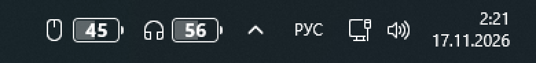
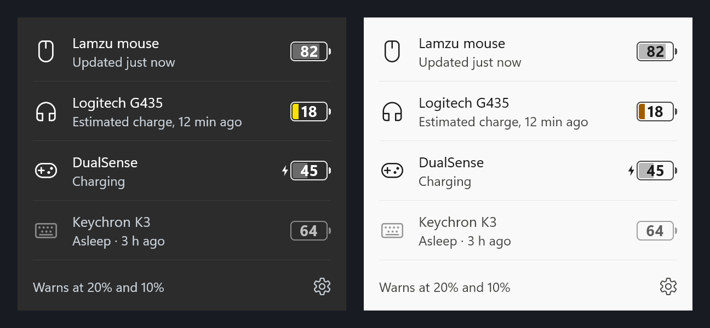

# BatteryStrip

**[Русский](README.ru.md)** · English

A tiny strip on the Windows 11 taskbar, right next to the clock, that shows the charge of your wireless devices:
mouse, headset, controller, keyboard. It finds them by itself and shows as many as are connected.



> **Beta.** Three devices have been tested on real hardware so far: a Lamzu mouse, a Logitech G435 headset and a JBL Charge 6.
> Everything else is implemented from public protocol documentation and needs testers.
> If your device is listed below, please tell us whether it works.

- **A bold number on a soft plate.** Each device has its icon and a rounded plate with the charge on it. The charge also
  shows as a lighter part of the plate, but the number keeps one colour all the way across, so it never splits where
  the fill ends. The fill turns yellow at 20% and below and red at 10% and below (Windows' own warning colours), and a
  small bolt shows charging. A bare plate with a dim number means the device sleeps and shows its last known value; a
  dash means it does not report its charge.
- **Click** the strip for the list of devices with their state. The gear opens the settings.
- **Notifications** when a device drops to 20% and to 10%, once each.
- **Follows the taskbar**: light or dark theme, Explorer restarts, sleep, a crowded taskbar (the icons go first,
  then the devices move to tray icons).
- **Small and quiet**: one file of about 500 KB, about 35 MB of memory, close to zero CPU. No administrator rights,
  no runtime to install, no ads, no telemetry. The only network access is an optional daily update check.
- **Stays out of games.** While a full-screen game or video is in front, the app sends nothing to devices and leaves
  the taskbar alone; it only listens to what devices send by themselves. It injects into no process, installs no
  driver and hooks no input.
- **Languages**: Russian and English, following Windows.



## Install

1. Download `BatteryStrip-<version>.exe` from [Releases](../../releases).
2. Run it and confirm. It installs for the current user only, without administrator rights, and starts with Windows.
3. The strip appears as soon as the first device reports its charge.

**"Windows protected your PC"**: the app has no paid code-signing certificate yet, so SmartScreen warns about new
downloads. Click *More info* → *Run anyway*. Each release page lists the SHA-256 of the file. Releases built by the
[release workflow](.github/workflows/release.yml) also carry a build attestation you can check with
`gh attestation verify BatteryStrip-<version>.exe --repo kantemiir/BatteryStrip`.

**Update**: run the newer file, or turn on *Check for updates* under the gear.
**Uninstall**: *Settings → Apps → Installed apps → BatteryStrip → Uninstall*. Settings, log and autostart go too.

## Supported devices

| Devices | How the charge is read | Tested |
|---|---|---|
| Mice on the COMPX chipset (receiver 25A7): **Lamzu**, Ajazz, Attack Shark, VXE and others | Exact percent and charging state. If the vendor app is running, its own requests are reused and the mouse is not asked again. | Lamzu ✔ |
| **Logitech G435** on its own receiver (046D:0ACB) | Estimated from the battery voltage. Reading pauses the headset's audio for about a second, so it is **off until you agree**; then it happens at most every 30 minutes and only during silence. | ✔ |
| **Logitech HID++** mice, keyboards and headsets on Unifying, Bolt, Lightspeed and by cable (G Pro, G305, G502 X, MX Master, G733, G535 and others), including older Unifying devices (HID++ 1.0) | Exact percent or a voltage estimate, depending on the device; G533, G535, G633–G935 and G PRO headsets have their own voltage curves. Standard read requests, the same G HUB and Solaar send. | needs testers |
| **Razer** wireless mice, keyboards and dongles | Exact percent and charging state. | needs testers |
| **SteelSeries**: Arctis 1, 7, 7+, 9, Pro, Pro Wireless, Nova 3P, 5, 7, 7X, 7P, Nova Pro Wireless, GameBuds; Aerox 3/5/9 Wireless, Prime Wireless, Rival 3 Wireless, Rival 650, Rival Pro | Percent or level steps, depending on the model, and charging state where the device reports it. | needs testers |
| **Corsair**: Void, Void Pro, Void Elite, HS70, HS80; Virtuoso, Void V2, HS80 MAX, Slipstream mice and keyboards | Percent and charging state. Newer devices get a read-only request; the app never switches them to software mode. | needs testers |
| **HyperX**: Cloud III Wireless, Cloud II Wireless, Cloud Alpha Wireless, Cloud Alpha 2 Wireless, Cloud Flight | Percent and charging state; the Cloud Flight is estimated from its voltage. | needs testers |
| **Glorious** Model O / O- / D / D- Wireless, Model O 2, Model D 2 PRO; **Hitscan** Hyperlight | Percent and charging state. | needs testers |
| **Kysona**, **Pulsar** and **ATK / VXE** mice on their own dongles | Percent and charging state. | needs testers |
| **ATK N9 Pro** headset | Percent and charging state over the headset's USB serial port. While the ATK app runs, it holds the port and the headset is skipped. | needs testers |
| **Any HID device** that reports its charge the standard way (HID *Battery Strength*) | The value the device reports, without a vendor protocol. | needs testers |
| Headsets supported by **[HeadsetControl](https://github.com/Sapd/HeadsetControl)** (Audeze, Jabra, Sony INZONE and more) | Only if you installed HeadsetControl yourself, next to the app or on PATH: the app runs `headsetcontrol -o json` every 5 minutes and shows what it reports. It is not bundled. | needs testers |
| **JBL speakers** paired with this PC (Charge 6; likely Charge 5, Flip 6 and other models the JBL Portable app drives) | Windows does not know their charge, so the speaker is asked over Bluetooth Low Energy, with the same read request the JBL Portable app sends: exact percent and charging state, every 10 minutes while the speaker is connected. Music plays on undisturbed. Other people's JBL speakers nearby are not touched. | Charge 6 ✔ |
| **Bluetooth** headphones, speakers, mice, keyboards (AirPods, Sony, JBL and others) | The value Windows shows in *Settings → Bluetooth*, read from Windows without touching the device. | needs testers |
| **DualSense**, DualSense Edge, **DualShock 4**, by cable and Bluetooth | In 10% steps, with charging state, from the reports the controller sends anyway. Over Bluetooth the charge shows once a game or Steam has switched the controller to full reports: the app never switches it itself, so games that read the controller directly keep working. | needs testers |
| **Xbox** and compatible controllers | What Windows reports for the controller. | needs testers |

Not supported yet: other vendor-specific protocols. If your device is missing, see below.

### Your device is missing or wrong?

Turn the device on, click the strip, then the gear → *Report a device*. In under a minute a folder opens with
`diagnose.txt` selected: the HID devices of the computer and what the app could read. It contains device codes and
names only and is not sent anywhere by itself. Attach it to a
[device request](../../issues/new?template=device_request.yml) and say what charge the device's own app shows.

The same from a command prompt: `"%LOCALAPPDATA%\Programs\BatteryStrip\BatteryStrip.exe" --diagnose`.

## Settings

The gear in the device list: start with Windows, low battery warnings, G435 reading, update check, refresh now,
log, exit. A few more options live in `%LOCALAPPDATA%\BatteryStrip\settings.txt`:

```
# ru, en, or empty to follow Windows
language = en
# your own name for a device; ids are in the log and the --diagnose report
name compx:25A7:FA7C = Lamzu Atlantis
```

## How it works

The strip is a transparent child window of the taskbar, placed left of the notification area and redrawn when
devices, theme or scale change. A watchdog re-attaches it after Explorer restarts or sleep; if Windows does not let it
attach, tray icons stand in. The window's thread only draws: device work happens on other threads, because a child
window shares its input queue with Explorer.

Design notes: [docs/design.md](docs/design.md). Device protocols: [research/devices.md](research/devices.md).

## Building

.NET SDK 8 or newer. The app targets .NET Framework 4.8, which is part of Windows 10 and 11.

```
dotnet test
powershell -ExecutionPolicy Bypass -File scripts\build.ps1
```

The second command runs the tests and writes `dist\BatteryStrip-<version>.exe` with its SHA-256.

Development switches: `--run` (run in place, without the installer), `--tray` (also show tray icons),
`--preview file.png` and `--preview-flyout file.png` (render the UI), `--lang ru|en`, `--diagnose`, `--exit`.

## Credits

Thank you to **[Wireless Battery](https://github.com/krisgfx9/Wireless-Device-Battery-Monitor)** by krisgfx9 and its
contributors. Its research is where version 0.3.0-beta.6 got the support for Razer, SteelSeries, Corsair, HyperX,
Glorious, Hitscan, Kysona, Pulsar and ATK devices, the standard HID battery, older Logitech devices (HID++ 1.0), the
voltage curves of Logitech headsets and the HeadsetControl bridge. Our code is our own, written from the protocol facts;
Wireless Battery in turn builds on OpenRazer, HeadsetControl, rivalcfg, Solaar and the other projects listed in
[THIRD-PARTY-NOTICES.md](THIRD-PARTY-NOTICES.md). If BatteryStrip does not suit you, give theirs a try: a tiny C++ app
with an even longer device list.

## Privacy

No telemetry. See [PRIVACY.md](PRIVACY.md).

## License

[MIT](LICENSE). Protocol knowledge comes from open-source projects, see [THIRD-PARTY-NOTICES.md](THIRD-PARTY-NOTICES.md).
Logitech, Lamzu, Sony, Microsoft, Xbox and other names are trademarks of their owners; this project is not affiliated with them.
