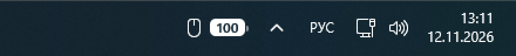
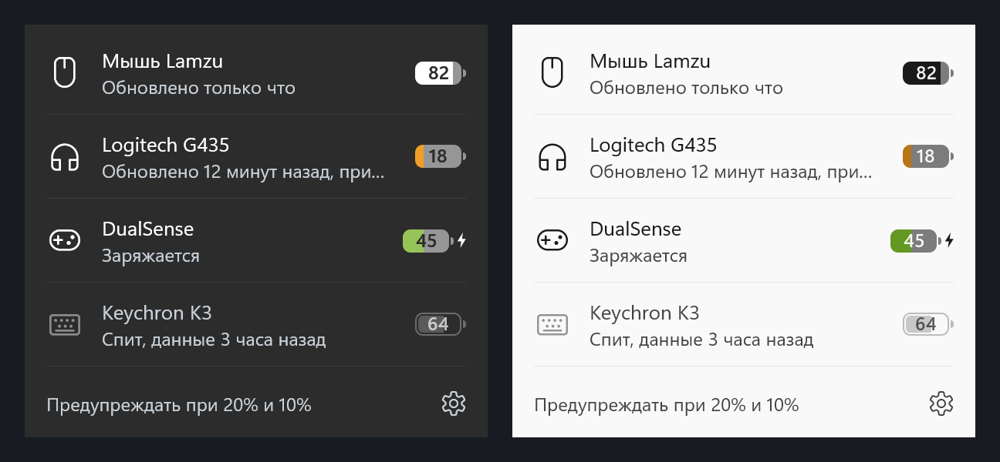

# Заряд устройств (BatteryStrip)

Русский · **[English](README.md)**

Маленькая полоска на панели задач Windows 11, вплотную слева от значков у часов. Она показывает заряд беспроводных
устройств: мыши, наушников, геймпада, клавиатуры. Программа сама находит подключённые устройства и показывает столько, сколько подключено.



> **Бета.** На настоящих устройствах пока проверены два: мышь Lamzu и наушники Logitech G435. Остальное сделано
> по открытой документации протоколов, и нужны тестеры. Если ваше устройство есть в списке ниже — напишите, работает ли оно.

- **Цвета.** Обычный заряд — белым на тёмной панели и чёрным на светлой. 20 % и меньше — жёлтым, 10 % и меньше — красным.
  При зарядке заливка зелёная и рядом молния. Спящее устройство приглушено и показывает последнее известное значение.
  Прочерк значит, что устройство не сообщает заряд.
- **Клик по полоске** открывает список устройств с их состоянием. Шестерёнка — настройки.
- **Уведомление Windows**, когда заряд опускается до 20 % и до 10 %, по одному разу.
- **Подстраивается под панель**: светлая и тёмная тема, перезапуск Проводника, сон, тесная панель.
  Если значки приложений доходят до полоски, сначала прячутся иконки устройств, а если места совсем нет,
  устройства переезжают в значки у часов.
- **Маленькая и тихая**: один файл 300 КБ, около 25 МБ памяти, почти ноль процессора. Права администратора не нужны,
  ничего доустанавливать не надо, рекламы и телеметрии нет. В интернет программа ходит только для проверки обновлений,
  если вы её включите.
- **Язык**: русский или английский, как в Windows.



## Установка

1. Скачайте `BatteryStrip-<версия>.exe` со страницы [Releases](../../releases). На второй компьютер файл можно перенести на флешке или через LocalSend.
2. Запустите его и нажмите «ОК». Программа установится для текущего пользователя, права администратора не нужны.
3. Полоска появится, как только программа прочитает заряд первого устройства.

Дальше программа запускается сама при входе в Windows.

**Синее окно «Система Windows защитила ваш компьютер»**: у программы пока нет платной цифровой подписи. Нажмите
«Подробнее», затем «Выполнить в любом случае». На странице каждого релиза указана контрольная сумма SHA-256 файла.
У версий, собранных на серверах GitHub, есть ещё запись о сборке, которую можно проверить командой
`gh attestation verify BatteryStrip-<версия>.exe --repo kantemiir/BatteryStrip`.

**Обновление**: запустите файл новой версии или включите «Проверять обновления» в шестерёнке.
**Удаление**: «Параметры → Приложения → Установленные приложения → Заряд устройств → Удалить». Программа удалит себя,
свои настройки, журнал и автозапуск.

## Какие устройства поддерживаются

| Устройства | Как читается заряд | Проверено |
|---|---|---|
| Мыши на чипсете COMPX (приёмник 25A7): **Lamzu**, Ajazz, Attack Shark, VXE и другие | Точный процент и признак зарядки. Если запущена программа производителя, используются её же ответы, и мышь лишний раз не опрашивается. | Lamzu ✔ |
| **Logitech G435** через свой приёмник (046D:0ACB) | Примерный процент по напряжению. При чтении звук в наушниках прерывается примерно на секунду, поэтому **без вашего согласия чтение выключено**. После согласия — не чаще раза в 30 минут и только в тишине. | ✔ |
| **Logitech HID++**: мыши, клавиатуры и гарнитуры на приёмниках Unifying, Bolt, Lightspeed и по проводу (G Pro, G305, G502 X, MX Master, G733, G535 и другие) | Точный процент или оценка по напряжению, смотря что умеет устройство. Стандартные запросы чтения, те же, что отправляют G HUB и Solaar. | нужны тестеры |
| **Bluetooth**: наушники, колонки, мыши, клавиатуры (AirPods, Sony, JBL и другие) | То же значение, что Windows показывает в «Параметрах → Bluetooth». Программа читает его у Windows и устройство не трогает. | нужны тестеры |
| **DualSense**, DualSense Edge, **DualShock 4** — по проводу и Bluetooth | С шагом 10 % и признаком зарядки, из данных, которые геймпад и так присылает. | нужны тестеры |
| **Геймпады Xbox** и совместимые | То, что сообщает о геймпаде сама Windows. | нужны тестеры |

Пока не поддерживаются: Razer, SteelSeries, HyperX, Corsair и другие устройства со своими протоколами.

### Вашего устройства нет или оно показывается неверно?

Включите устройство, нажмите на полоску, затем шестерёнка → «Сообщить об устройстве». Меньше чем через минуту
откроется папка с выделенным файлом `diagnose.txt`. В нём список HID-устройств компьютера и то, что программа смогла
прочитать: только коды и названия устройств, сам файл никуда не отправляется. Приложите его к
[запросу на устройство](../../issues/new?template=device_request.yml) и напишите, какой заряд показывает родная
программа устройства.

То же самое из командной строки: `"%LOCALAPPDATA%\Programs\BatteryStrip\BatteryStrip.exe" --diagnose`.

## Настройки

В шестерёнке окна по клику: автозапуск, предупреждения о низком заряде, чтение G435, проверка обновлений,
«Обновить заряд сейчас», журнал и выход. Ещё несколько настроек — в файле `%LOCALAPPDATA%\BatteryStrip\settings.txt`:

```
language = ru                         # ru, en или пусто — как в Windows
name compx:25A7:FA7C = Lamzu Atlantis # своё название устройства; id есть в журнале и в отчёте --diagnose
```

## Если что-то пошло не так

- **Полоска пропала.** После перезапуска Проводника или выхода из сна она возвращается сама за пару секунд.
  Если Windows не даёт прикрепиться к панели, через 20 секунд устройства появятся значками у часов.
- **Журнал**: шестерёнка → «Открыть журнал» или файл `%LOCALAPPDATA%\BatteryStrip\logs\app.log`.

## Сборка

Нужен .NET SDK 8 или новее. Программа собирается под .NET Framework 4.8, которая встроена в Windows 10 и 11.

```
dotnet test
powershell -ExecutionPolicy Bypass -File scripts\build.ps1
```

Вторая команда прогоняет тесты и кладёт `dist\BatteryStrip-<версия>.exe` вместе с контрольной суммой.

## Приватность и лицензия

Телеметрии нет, подробнее — в [PRIVACY.md](PRIVACY.md). Лицензия [MIT](LICENSE). Знания о протоколах устройств взяты из
открытых проектов, см. [THIRD-PARTY-NOTICES.md](THIRD-PARTY-NOTICES.md). Logitech, Lamzu, Sony, Microsoft, Xbox и другие
названия — товарные знаки их владельцев; проект с ними не связан.
