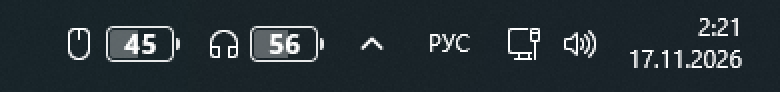
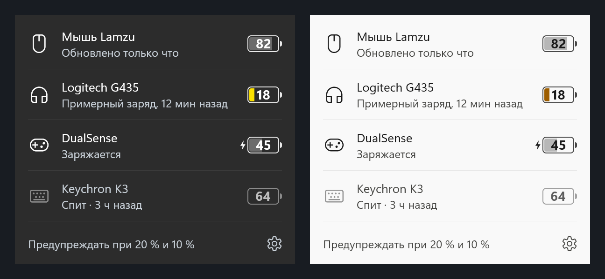

# Заряд устройств (BatteryStrip)

Русский · **[English](README.md)**

Маленькая полоска на панели задач Windows 11, вплотную слева от значков у часов. Она показывает заряд беспроводных
устройств: мыши, наушников, геймпада, клавиатуры. Программа сама находит подключённые устройства и показывает столько, сколько подключено.



> **Бета.** На настоящих устройствах пока проверены три: мышь Lamzu, наушники Logitech G435 и колонка JBL Charge 6. Остальное сделано
> по открытой документации протоколов, и нужны тестеры. Если ваше устройство есть в списке ниже — напишите, работает ли оно.

- **Жирная цифра на мягкой плашке.** У каждого устройства значок и скруглённая плашка с зарядом. Уровень виден
  и как более светлая часть плашки, но цифра на всём протяжении одного цвета, поэтому её край заливки никогда не
  разрезает. При 20 % и меньше заливка жёлтая, при 10 % и меньше — красная (цвета предупреждений самой Windows),
  маленькая молния — идёт зарядка. Пустая плашка с бледной цифрой — устройство спит, в ней последнее известное
  значение. Прочерк — устройство не сообщает заряд.
- **Клик по полоске** открывает список устройств с их состоянием. Шестерёнка — настройки.
- **Уведомление Windows**, когда заряд опускается до 20 % и до 10 %, по одному разу.
- **Подстраивается под панель**: светлая и тёмная тема, перезапуск Проводника, сон, тесная панель.
  Если значки приложений доходят до полоски, сначала прячутся иконки устройств, а если места совсем нет,
  устройства переезжают в значки у часов.
- **Маленькая и тихая**: один файл около 500 КБ, около 35 МБ памяти, почти ноль процессора. Права администратора не нужны,
  ничего доустанавливать не надо, рекламы и телеметрии нет. В интернет программа ходит только для проверки обновлений,
  если вы её включите.
- **Не мешает играм.** Пока на экране полноэкранная игра или видео, программа ничего не отправляет устройствам и не
  трогает панель задач, только слушает то, что устройства присылают сами. В игры и в другие процессы она не встраивается,
  драйверов не ставит, ввод не перехватывает.
- **Язык**: русский или английский, как в Windows.



## Установка

1. Скачайте `BatteryStrip-<версия>.exe` со страницы [Releases](../../releases). На второй компьютер файл можно перенести на флешке или через LocalSend.
2. Запустите его и нажмите «ОК». Программа установится для текущего пользователя, права администратора не нужны.
3. Полоска появится, как только программа прочитает заряд первого устройства.

Дальше программа запускается сама при входе в Windows.

**Синее окно «Система Windows защитила ваш компьютер»**: у программы пока нет платной цифровой подписи. Нажмите
«Подробнее», затем «Выполнить в любом случае». На странице каждого релиза указана контрольная сумма SHA-256 файла.
У версий, собранных на серверах GitHub, есть ещё запись о сборке, которую можно проверить командой
`gh attestation verify BatteryStrip-<версия>.exe --repo kantemiir/BatteryStrip`.

**Обновление**: запустите файл новой версии или включите «Проверять обновления» в шестерёнке.
**Удаление**: «Параметры → Приложения → Установленные приложения → Заряд устройств → Удалить». Программа удалит себя,
свои настройки, журнал и автозапуск.

## Какие устройства поддерживаются

| Устройства | Как читается заряд | Проверено |
|---|---|---|
| Мыши на чипсете COMPX (приёмник 25A7): **Lamzu**, Ajazz, Attack Shark, VXE и другие | Точный процент и признак зарядки. Если запущена программа производителя, используются её же ответы, и мышь лишний раз не опрашивается. | Lamzu ✔ |
| **Logitech G435** через свой приёмник (046D:0ACB) | Примерный процент по напряжению. При чтении звук в наушниках прерывается примерно на секунду, поэтому **без вашего согласия чтение выключено**. После согласия — не чаще раза в 30 минут и только в тишине. | ✔ |
| **Logitech HID++**: мыши, клавиатуры и гарнитуры на приёмниках Unifying, Bolt, Lightspeed и по проводу (G Pro, G305, G502 X, MX Master, G733, G535 и другие), в том числе старые устройства Unifying (HID++ 1.0) | Точный процент или оценка по напряжению, смотря что умеет устройство; у гарнитур G533, G535, G633–G935 и G PRO своя кривая напряжения. Стандартные запросы чтения, те же, что отправляют G HUB и Solaar. | нужны тестеры |
| **Razer**: беспроводные мыши, клавиатуры и приёмники | Точный процент и признак зарядки. | нужны тестеры |
| **SteelSeries**: Arctis 1, 7, 7+, 9, Pro, Pro Wireless, Nova 3P, 5, 7, 7X, 7P, Nova Pro Wireless, GameBuds; Aerox 3/5/9 Wireless, Prime Wireless, Rival 3 Wireless, Rival 650, Rival Pro | Процент или ступени заряда, смотря какая модель, и признак зарядки, если устройство его сообщает. | нужны тестеры |
| **Corsair**: Void, Void Pro, Void Elite, HS70, HS80; Virtuoso, Void V2, HS80 MAX, мыши и клавиатуры Slipstream | Процент и признак зарядки. Новым устройствам отправляется только запрос чтения; в программный режим программа их не переключает. | нужны тестеры |
| **HyperX**: Cloud III Wireless, Cloud II Wireless, Cloud Alpha Wireless, Cloud Alpha 2 Wireless, Cloud Flight | Процент и признак зарядки; у Cloud Flight оценка по напряжению. | нужны тестеры |
| **Glorious** Model O / O- / D / D- Wireless, Model O 2, Model D 2 PRO; **Hitscan** Hyperlight | Процент и признак зарядки. | нужны тестеры |
| Мыши **Kysona**, **Pulsar** и **ATK / VXE** на своих приёмниках | Процент и признак зарядки. | нужны тестеры |
| Наушники **ATK N9 Pro** | Процент и признак зарядки через USB-порт наушников (виртуальный COM). Пока запущена программа ATK, порт занят ею, и наушники пропускаются. | нужны тестеры |
| **Любое HID-устройство**, которое сообщает заряд стандартным способом (HID *Battery Strength*) | Значение, которое сообщает само устройство, без протокола производителя. | нужны тестеры |
| Наушники, которые знает **[HeadsetControl](https://github.com/Sapd/HeadsetControl)** (Audeze, Jabra, Sony INZONE и другие) | Только если вы сами поставили HeadsetControl, рядом с программой или в PATH: раз в 5 минут программа запускает `headsetcontrol -o json` и показывает, что он сообщил. В комплект не входит. | нужны тестеры |
| **Колонки JBL**, сопряжённые с этим компьютером (Charge 6; вероятно, Charge 5, Flip 6 и другие модели из приложения JBL Portable) | Windows их заряд не знает, поэтому программа спрашивает колонку по Bluetooth LE тем же запросом чтения, что и приложение JBL Portable: точный процент и признак зарядки, раз в 10 минут, пока колонка подключена. Музыка при этом не прерывается. Чужие колонки JBL поблизости программа не трогает. | Charge 6 ✔ |
| **Bluetooth**: наушники, колонки, мыши, клавиатуры (AirPods, Sony, JBL и другие) | То же значение, что Windows показывает в «Параметрах → Bluetooth». Программа читает его у Windows и устройство не трогает. | нужны тестеры |
| **DualSense**, DualSense Edge, **DualShock 4** — по проводу и Bluetooth | С шагом 10 % и признаком зарядки, из данных, которые геймпад и так присылает. По Bluetooth заряд виден, когда игра или Steam включили у геймпада полный режим отчётов: программа сама режим не переключает, чтобы не сломать игры, которые читают геймпад напрямую. | нужны тестеры |
| **Геймпады Xbox** и совместимые | То, что сообщает о геймпаде сама Windows. | нужны тестеры |

Пока не поддерживаются другие устройства со своими протоколами. Если вашего нет в списке, см. ниже.

### Вашего устройства нет или оно показывается неверно?

Включите устройство, нажмите на полоску, затем шестерёнка → «Сообщить об устройстве». Меньше чем через минуту
откроется папка с выделенным файлом `diagnose.txt`. В нём список HID-устройств компьютера и то, что программа смогла
прочитать: только коды и названия устройств, сам файл никуда не отправляется. Приложите его к
[запросу на устройство](../../issues/new?template=device_request.yml) и напишите, какой заряд показывает родная
программа устройства.

То же самое из командной строки: `"%LOCALAPPDATA%\Programs\BatteryStrip\BatteryStrip.exe" --diagnose`.

## Настройки

В шестерёнке окна по клику: автозапуск, предупреждения о низком заряде, чтение G435, проверка обновлений,
«Обновить заряд сейчас», журнал и выход. Ещё несколько настроек — в файле `%LOCALAPPDATA%\BatteryStrip\settings.txt`:

```
# ru, en или пусто — как в Windows
language = ru
# своё название устройства; id есть в журнале и в отчёте --diagnose
name compx:25A7:FA7C = Lamzu Atlantis
```

## Если что-то пошло не так

- **Полоска пропала.** После перезапуска Проводника или выхода из сна она возвращается сама за пару секунд.
  Если Windows не даёт прикрепиться к панели, через 20 секунд устройства появятся значками у часов.
- **Журнал**: шестерёнка → «Открыть журнал» или файл `%LOCALAPPDATA%\BatteryStrip\logs\app.log`.

## Сборка

Нужен .NET SDK 8 или новее. Программа собирается под .NET Framework 4.8, которая встроена в Windows 10 и 11.

```
dotnet test
powershell -ExecutionPolicy Bypass -File scripts\build.ps1
```

Вторая команда прогоняет тесты и кладёт `dist\BatteryStrip-<версия>.exe` вместе с контрольной суммой.

## Благодарности

Спасибо проекту **[Wireless Battery](https://github.com/krisgfx9/Wireless-Device-Battery-Monitor)**: krisgfx9 и его
соавторам. Из их исследований в версию 0.3.0-beta.6 пришли поддержка Razer, SteelSeries, Corsair, HyperX, Glorious,
Hitscan, Kysona, Pulsar и ATK, стандартный HID-заряд, старые устройства Logitech (HID++ 1.0), кривые напряжения гарнитур
Logitech и мост к HeadsetControl. Код у нас свой, написан по фактам о протоколах; сам Wireless Battery опирается на
OpenRazer, HeadsetControl, rivalcfg, Solaar и другие проекты из [THIRD-PARTY-NOTICES.md](THIRD-PARTY-NOTICES.md).
Если наша программа вам не подошла, попробуйте их: крошечное приложение на C++ с ещё более длинным списком устройств.

## Приватность и лицензия

Телеметрии нет, подробнее — в [PRIVACY.md](PRIVACY.md). Лицензия [MIT](LICENSE). Знания о протоколах устройств взяты из
открытых проектов, см. [THIRD-PARTY-NOTICES.md](THIRD-PARTY-NOTICES.md). Logitech, Lamzu, Sony, Microsoft, Xbox и другие
названия — товарные знаки их владельцев; проект с ними не связан.
